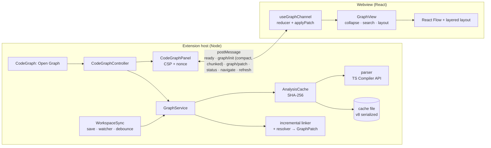

# Contributing to CodeGraph Map

Thanks for your interest! Issues and pull requests are welcome at
<https://github.com/kevincoto18/codegraph>.

## Development requirements

- **VS Code** 1.95 or newer
- **Node.js** 20+ (22 recommended) and npm

## Running from source

```bash
npm install
npm run build
```

Then press **F5** in VS Code and pick a launch configuration:

| Configuration                     | Opens                                                                            |
| --------------------------------- | -------------------------------------------------------------------------------- |
| **Run CodeGraph**                 | The Extension Development Host with the last folder you used there               |
| **Run CodeGraph on demo project** | The Extension Development Host on [`samples/demo-project`](samples/demo-project) |

Both configurations build first and start the host with `--disable-extensions`,
so only CodeGraph is loaded. In the new window run **`CodeGraph: Open Graph`**
from the Command Palette (`Ctrl+Shift+P`).

## Quality bar

- English code, TSDoc on every function, strict TypeScript.
- `npm run typecheck`, `npm run lint` (zero warnings), `npm run format:check`
  and `npm test` must pass; CI runs them on every push, plus the integration
  tests.
- Keep pure modules free of `vscode` imports so they stay unit-testable.

## Architecture



### Project layout

```
src/
├─ shared/        Environment-agnostic contract: graph model, ids, message protocol + guards
├─ extension/     VS Code host
│  ├─ analyzer/   Pure analysis: language registry, one language/parser pair per language, symbol table (namespaces, types), linker, incremental linker, diff
│  ├─ cache.ts, cacheStore.ts, exclusions.ts, graphService.ts, changeScheduler.ts   Pure orchestration (unit-tested)
│  ├─ analysis.ts Entry of the analyzer bundle (`dist/analysis.js`), loaded on first use
│  └─ controller.ts, panel.ts, workspaceSync.ts, workspaceReader.ts, navigation.ts   VS Code adapters
└─ webview/       React app: channel, flow conversion, collapse, search, layout, patches, components
samples/demo-project/   Mixed TS/JS project covering every supported construct
```

Pure modules never import `vscode`; VS Code access goes through thin adapters
(`WorkspaceReader` port, `WorkspaceSync`, `CodeGraphPanel`), which keeps the
analysis and the webview logic unit-testable.

### Data model

Defined in [`src/shared/types.ts`](src/shared/types.ts): `GraphNode`
(`file` | `function`, with `filePath` and 1-based `line`), `GraphEdge`
(`import` | `call`), `GraphSnapshot` and `GraphPatch`. Ids are stable and never
contain line numbers (`src/a.ts`, `src/a.ts#Class.method`), so editing code
above a function does not recreate its node. Full graphs travel to the webview
in a compact wire format ([`src/shared/wire.ts`](src/shared/wire.ts)): file
paths are sent once, ids are derived and edges are node indexes, split into
chunks.

### Performance design

- **Instant activation**: the analyzer and the TypeScript compiler it embeds
  live in a separate bundle loaded the first time a graph is opened.
- **Warm starts**: the parse cache is saved in the workspace storage (V8
  serialization) and reused when files keep their modification time and size.
- **Cheap saves**: queued changes are applied as one batch, and only the
  changed files, the files whose imports may now resolve differently and the
  importers of changed files are re-linked.
- **Instant reopen**: the last graph is saved too and shown immediately; the
  rescan then sends only what changed.
- **Parallel parsing**: large scans (3,000+ files) parse on worker threads
  (`dist/parseWorker.js`) as well as the main thread.
- **Large canvases**: the canvas mounts at its final zoom, skips edges while
  zoomed out on very large graphs, and **Expand all** stops at 15,000 nodes.

## Scripts

| Script                                      | Purpose                                                                                                                                                           |
| ------------------------------------------- | ----------------------------------------------------------------------------------------------------------------------------------------------------------------- |
| `npm run build`                             | Bundle the extension and analyzer (esbuild) and the webview (Vite)                                                                                                |
| `npm run watch:extension` / `watch:webview` | Rebuild on change                                                                                                                                                 |
| `npm test` / `npm run test:watch`           | Unit and integration tests (Vitest)                                                                                                                               |
| `npm run test:integration`                  | Tests inside a real VS Code window (`@vscode/test-cli`): commands, panel, Show Connections, live updates, multi-root. Downloads VS Code once into `.vscode-test/` |
| `npm run typecheck`                         | Type-check host and webview projects                                                                                                                              |
| `npm run lint`                              | ESLint (strict type-checked, TSDoc required), zero warnings                                                                                                       |
| `npm run format` / `format:check`           | Prettier                                                                                                                                                          |

## Testing

`npm test` runs ~300 tests: parser, resolver, linker (incremental linking is
checked against a full relink on random workspaces), diff, cache and its
persistence, exclusions, wire format, graph service (in-memory workspace), change scheduler, webview HTML/CSP, and every
pure webview module (flow conversion, collapse, search, layout, patches).
`src/extension/demoProject.test.ts` analyzes `samples/demo-project` end to end
and asserts the complete expected graph (`pythonDemo.test.ts` and
`languageDemos.test.ts` do the same for the Python, Java, C# and Go samples).

`npm run test:integration` runs `src/test/integration` inside a real VS Code
window, twice: on `samples/demo-project` (commands, the graph panel, Show
Connections opening beside the editor, a created and deleted file updating
the graph) and on a multi-root workspace with the Python and Go samples.

## Troubleshooting development

| Symptom                                                          | Fix                                                                                                                                       |
| ---------------------------------------------------------------- | ----------------------------------------------------------------------------------------------------------------------------------------- |
| The Extension Development Host window closes right after opening | Another extension interfered. The launch configurations already pass `--disable-extensions`; also close any stale development host window |
| Slow `npm install` on OneDrive                                   | Exclude `node_modules` from OneDrive sync                                                                                                 |

## Releasing

1. Update `CHANGELOG.md` and the `version` in `package.json`.
2. `npm run package` builds `codegraph-map-<version>.vsix` locally for a last check.
3. Push a tag `v<version>`: the **Publish** workflow publishes to the VS Code
   Marketplace with Trusted Publishing (no token stored) and attaches the
   `.vsix` to a GitHub release.

## Roadmap

- **ELK layout** (`elkjs`): native compound graphs and orthogonal edge routing
- Optional **type checker** mode for precise `obj.method()` resolution
- Follow **re-exports** and resolve **`paths` aliases**
- Execution **simulation** on top of the current model (`nodes`, `edges`, `filePath`, `line`)
