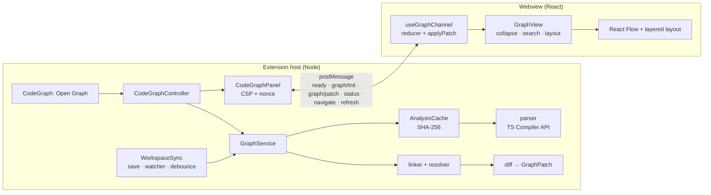

# CodeGraph

> VS Code extension (proof of concept) that statically analyzes a TypeScript /
> JavaScript project and renders an interactive, live-updating graph of its
> **files**, **functions**, **imports** and **calls**.

- Files are containers; their functions are nested nodes.
- Dashed edges are imports between files; solid edges are calls between functions.
- Click any node to jump to the exact line in the editor.
- Save a file and only that file is re-analyzed; the graph updates in place.

---

## Features

| Feature           | Details                                                                                                                                                                              |
| ----------------- | ------------------------------------------------------------------------------------------------------------------------------------------------------------------------------------ |
| Static analysis   | TypeScript Compiler API (`ts.createSourceFile`), no type checker, no LLM                                                                                                             |
| Languages         | `.ts`, `.tsx`, `.js`, `.jsx` (`.d.ts` skipped); `node_modules`, `dist`, `build`, `.git` ignored                                                                                      |
| Imports           | ES default / named (aliased) / namespace / side-effect, re-exports, `require`, `import x = require()`                                                                                |
| Functions         | Declarations, arrow & function expressions assigned to variables, class methods, constructors, arrow class properties, anonymous default exports, CommonJS exported functions        |
| Calls             | `foo()`, `ns.foo()`, `this.foo()`, `Class.staticMethod()` — local or imported (ES and CommonJS)                                                                                      |
| Navigation        | Click a file or function to open it at its line, in a column next to the graph                                                                                                       |
| Large projects    | Auto-collapse above 400 functions, linear layered layout (tall ranks wrapped into sub-columns), level of detail when zoomed out, auto-hidden minimap, only visible elements rendered |
| Collapse / expand | Per file or all at once; calls of collapsed files are merged into `×n` edges                                                                                                         |
| Search            | By file path or function name; matches highlighted, Enter zooms to them, Escape clears                                                                                               |
| Live updates      | Saves, external edits, created/deleted files and folders → debounced per file → incremental patch                                                                                    |
| Layout stability  | Live patches keep file positions (including manual drags), collapsed files, search and viewport                                                                                      |
| Cache             | Per-file SHA-256 content hash; unchanged files are never re-parsed                                                                                                                   |

## Requirements

- **VS Code** 1.95 or newer
- **Node.js** 20+ (22 recommended) and npm

## Getting started

```bash
npm install
npm run build
```

Then press **F5** in VS Code and pick a launch configuration:

| Configuration                     | Opens                                                                            |
| --------------------------------- | -------------------------------------------------------------------------------- |
| **Run CodeGraph**                 | The Extension Development Host with the last folder you used there               |
| **Run CodeGraph on demo project** | The Extension Development Host on [`samples/demo-project`](samples/demo-project) |

Both configurations build first and start the host with `--disable-extensions`,
so only CodeGraph is loaded. In the new window run **`CodeGraph: Open Graph`**
from the Command Palette (`Ctrl+Shift+P`).

## Usage

| Action                       | How                                                                     |
| ---------------------------- | ----------------------------------------------------------------------- |
| Open the graph               | `CodeGraph: Open Graph`                                                 |
| Go to code                   | Click a function or a file header                                       |
| Collapse / expand a file     | `▸` / `▾` button in the file header                                     |
| Collapse / expand everything | **Collapse all** / **Expand all**                                       |
| Search                       | Type in the search box · **Enter** zooms to matches · **Escape** clears |
| Tidy the layout              | **Re-layout** (recomputes positions, e.g. after many live changes)      |
| Full rescan                  | **Refresh**                                                             |
| Zoom / pan / move files      | Mouse wheel · drag the background · drag a file header                  |

Logs are written to the **CodeGraph** output channel (`Ctrl+Shift+U`).

## Architecture



### Project layout

```
src/
├─ shared/        Environment-agnostic contract: graph model, ids, message protocol + guards
├─ extension/     VS Code host
│  ├─ analyzer/   Pure analysis: config, parser, resolver, linker, diff
│  ├─ cache.ts, graphService.ts, changeScheduler.ts   Pure orchestration (unit-tested)
│  └─ controller.ts, panel.ts, workspaceSync.ts, workspaceReader.ts, navigation.ts   VS Code adapters
└─ webview/       React app: channel, flow conversion, collapse, search, layout, patches, components
samples/demo-project/   Mixed TS/JS project covering every supported construct
```

Pure modules never import `vscode`; VS Code access goes through thin adapters
(`WorkspaceReader` port, `WorkspaceSync`, `CodeGraphPanel`), which keeps the
analysis and the webview logic unit-testable.

### Data model

Defined in [`src/shared/types.ts`](src/shared/types.ts): `GraphNode`
(`file` | `function`, with `filePath` and 1-based `line`), `GraphEdge`
(`import` | `call`), `GraphSnapshot` and `GraphPatch`. Ids are stable and never
contain line numbers (`src/a.ts`, `src/a.ts#Class.method`), so editing code
above a function does not recreate its node.

## Scripts

| Script                                      | Purpose                                                     |
| ------------------------------------------- | ----------------------------------------------------------- |
| `npm run build`                             | Bundle the extension (esbuild) and the webview (Vite)       |
| `npm run watch:extension` / `watch:webview` | Rebuild on change                                           |
| `npm test` / `npm run test:watch`           | Unit and integration tests (Vitest)                         |
| `npm run typecheck`                         | Type-check host and webview projects                        |
| `npm run lint`                              | ESLint (strict type-checked, TSDoc required), zero warnings |
| `npm run format` / `format:check`           | Prettier                                                    |

## Testing

`npm test` runs ~190 tests: parser, resolver, linker, diff, cache, graph
service (in-memory workspace), change scheduler, webview HTML/CSP, and every
pure webview module (flow conversion, collapse, search, layout, patches).
`src/extension/demoProject.test.ts` analyzes `samples/demo-project` end to end
and asserts the complete expected graph.

## Known limitations

- Calls through **barrel re-exports** (`export … from`) are not followed (the file edge is shown).
- **Path aliases** (`tsconfig` `paths`, e.g. `@/utils`) are not resolved; only relative imports are.
- Calls on arbitrary objects (`obj.method()`, `a.b.c()`, `new X().m()`) are not resolved.
- Nested functions are not nodes; their calls are attributed to the enclosing function.
- Only the **first workspace folder** is analyzed; up to 5000 files.
- Collapse/expand and **Re-layout** recompute positions, discarding manual drags.
- TypeScript is pinned to **6.0.x**: TypeScript 7 (native port) does not expose the classic JS Compiler API.

## Troubleshooting

| Symptom                                                          | Fix                                                                                                                                                                             |
| ---------------------------------------------------------------- | ------------------------------------------------------------------------------------------------------------------------------------------------------------------------------- |
| The Extension Development Host window closes right after opening | Another extension (e.g. one that patches the workbench) interfered. The launch configurations already pass `--disable-extensions`; also close any stale development host window |
| The graph is empty                                               | Make sure a folder with `.ts/.js` files is open in the development host, then press **Refresh**                                                                                 |
| Slow `npm install` on OneDrive                                   | Exclude `node_modules` from OneDrive sync                                                                                                                                       |

## Roadmap

- **ELK layout** (`elkjs`): native compound graphs and orthogonal edge routing
- Optional **type checker** mode for precise `obj.method()` resolution
- Follow **re-exports** and resolve **`paths` aliases**
- **Multi-root** workspaces
- Execution **simulation** on top of the current model (`nodes`, `edges`, `filePath`, `line`)

## License

UNLICENSED — private proof of concept.
