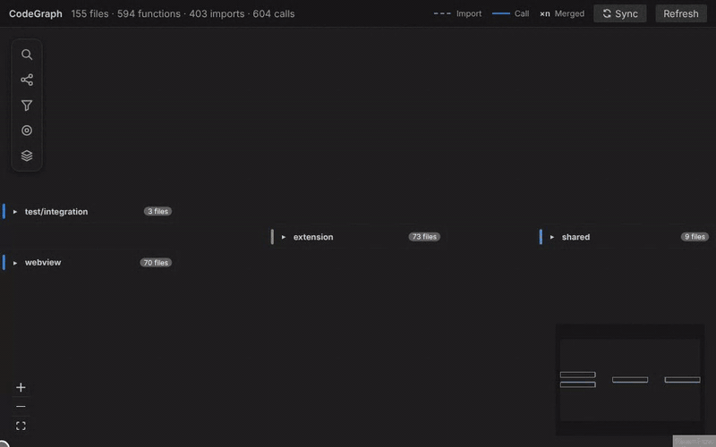
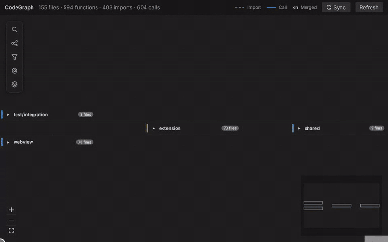
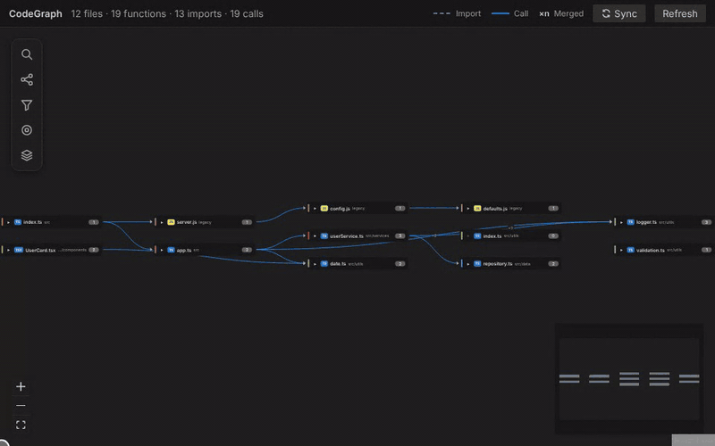

# CodeGraph Map

**See how your code fits together.** CodeGraph Map draws an interactive,
live-updating graph of your project's **files**, **functions**, **imports** and
**calls** right inside VS Code: click any node to jump to the code.

Works with **TypeScript / JavaScript, Python, Java, C# and Go**. Everything is
computed locally by static analysis: no language server, no account, no AI,
nothing leaves your machine.

## Features

- **Files as containers, functions inside them.** Dashed edges are imports
  between files, solid edges are calls between functions.
- **Jump to code.** Click a file or function to open it at its line, beside the
  graph.
- **Live.** Save a file and only what changed is re-analyzed; the graph updates
  in place and keeps your layout.
- **Scales to large projects.** Folders open on demand, files start collapsed and
  connections between collapsed groups are merged into `×n` edges.
- **Fuzzy search** (`Ctrl+F`) over files and functions.
- **Focus mode**: light up a function and what it uses or what uses it.
- **Show Connections** from the editor or the Explorer.
- **Filters**: hide tests, show only exported functions, hide folders, exclude
  patterns.
- **Follow the editor**: the graph tracks the function under your cursor.
- **Multi-root workspaces** in one graph, and the panel reopens after a reload
  with the same view.

## Getting started

1. Install **CodeGraph Map** from the Marketplace.
2. Open a folder with source code.
3. Run **`CodeGraph: Open Graph`** from the Command Palette (`Ctrl+Shift+P`),
   press `Ctrl+Alt+G` (`Cmd+Alt+G` on macOS) or click **CodeGraph** in the
   status bar.

To see the connections of the file you are editing, right-click in the editor
and choose **Show Connections**.

## Usage

| Action                   | How                                                                                                                                                                                                                                                                                                                                                                                                           |
| ------------------------ | ------------------------------------------------------------------------------------------------------------------------------------------------------------------------------------------------------------------------------------------------------------------------------------------------------------------------------------------------------------------------------------------------------------- |
| Open the graph           | `CodeGraph: Open Graph`                                                                                                                                                                                                                                                                                                                                                                                       |
| Go to code               | Click a function · on a file, **Ctrl/Cmd + click** or its open button (↗); right-click → _Go to code_                                                                                                                                                                                                                                                                                                         |
| Collapse / expand a file | Click the file (its whole header), or its `▸` / `▾` button                                                                                                                                                                                                                                                                                                                                                    |
| Open / close a folder    | Click the folder (or its `▸` / `▾` button)                                                                                                                                                                                                                                                                                                                                                                    |
| Settings & filters       | Icon rail at the top left; each icon opens its panel: **Search** (`Ctrl+F`), **Connections** (Imports · Calls · Calls inside a file; only Calls by default), **Filters**, **Focus** and **View** (Expand level · Expand all · Collapse all · Re-layout · Follow the editor · Minimap · Folder colors and their legend). Badges show active filters, focus and sync                                            |
| Focus mode               | **Double-click** a file or function, or **right-click** it → _Focus here_ / _Show what uses it_ / _Show what it uses_: only it and its neighbors stay lit, the rest is dimmed · while focusing, **click** another file or function to move the focus · distance (1–3 hops) and direction (**Both / Used by / Uses**) in the **Focus** panel · **Escape**, **Exit focus** or right-click → _Exit focus_ leaves |
| Path between two nodes   | Right-click a file or function → **Find path from here…**, then click the destination (or right-click it → **Path to here**): the shortest chain of calls (or imports between files) is highlighted and framed, with its steps in a bar at the top (click a step to go there). **Escape** or **×** clears it                                                                                                  |
| Function details         | Rest the pointer on a function: a card shows its signature, the first paragraph of its doc comment or docstring and where it is declared                                                                                                                                                                                                                                                                      |
| Show Connections         | Right-click a source file in the Explorer or inside the editor → **Show Connections**: opens the graph focused on that file (or on the function under the cursor)                                                                                                                                                                                                                                             |
| Filters                  | **Filters** panel: _Hide tests_ (`*.test.*`, `*.spec.*`, `test_*.py`, `__tests__/`…), _Only exported functions_, a folder tree with an eye button per folder, and exclude patterns (`**/generated/**`, `*.gen.ts`; without `/` a pattern matches a name at any depth). Shows how many files and functions are hidden · **Clear all** resets. Saved per workspace                                              |
| Follow the editor        | **Sync** in the toolbar (or _Follow the editor_ in **View**): the graph highlights and centers the file or function under the cursor, opening the folders that hide it; in focus mode the focus follows the cursor. Saved per workspace                                                                                                                                                                       |
| Search                   | **Enter** opens the folders/files hiding the matches and zooms to them · **Escape** clears                                                                                                                                                                                                                                                                                                                    |
| Folder colors            | A thin stripe on each file and folder, one stable color per folder                                                                                                                                                                                                                                                                                                                                            |
| Reload / reopen          | After a window reload the graph panel reopens by itself, with the same zoom and position, opened folders and files, focus and search (also when switching tabs)                                                                                                                                                                                                                                               |
| Several folders          | In a multi-root workspace every folder is analyzed in one graph. Each workspace folder is its own top-level node with its color, icon and languages; everything inside takes its color, the legend groups by workspace folder, **Filters → Workspace folders** hides a whole project and hovering shows `project › path`. Adding or removing a folder updates the graph                                       |
| Full rescan              | **Refresh**                                                                                                                                                                                                                                                                                                                                                                                                   |
| Zoom / pan / move files  | **Mouse:** wheel zooms, Shift + wheel pans sideways, drag the background to pan · **Touchpad:** two fingers pan, pinch zooms · **Keyboard:** arrows pan (Shift: faster), `+` / `-` zoom, `0` fits the graph · hold **Space** and drag to pan even over nodes · drag a file header to move it                                                                                                                  |
| Motion                   | Nodes slide to their new place after expanding or collapsing; large expansions appear progressively without freezing the view · going to a function (search, editor sync, focus) zooms in close to it, even inside a large file; tall files are shown from their header · when the editor opens beside the graph, the graph stays centered and the node you clicked stays in view                             |

Logs are written to the **CodeGraph** output channel (`Ctrl+Shift+U`).

### Settings

| Setting                       | Values                      | Default  | Effect                                                                                                                                                            |
| ----------------------------- | --------------------------- | -------- | ----------------------------------------------------------------------------------------------------------------------------------------------------------------- |
| `codegraph.collapseByDefault` | `always` · `auto` · `never` | `always` | Whether files start collapsed (`auto`: above 400 functions)                                                                                                       |
| `codegraph.folderView`        | `auto` · `always` · `never` | `auto`   | Group files into nested folders that open on demand (`auto`: above 300 files)                                                                                     |
| `codegraph.scrollBehavior`    | `auto` · `pan` · `zoom`     | `auto`   | What the wheel and two-finger scrolling do: `auto` zooms with a mouse wheel and pans with a touchpad; `pan` always pans (Ctrl + wheel zooms); `zoom` always zooms |

## Languages

| Language                | Parser                  | Files                                                       | Imports resolved                                                                                                                                                                                                              |
| ----------------------- | ----------------------- | ----------------------------------------------------------- | ----------------------------------------------------------------------------------------------------------------------------------------------------------------------------------------------------------------------------- |
| TypeScript / JavaScript | TypeScript Compiler API | `.ts` `.tsx` `.js` `.jsx` (not `.d.ts`)                     | Relative paths, `index` files, `.js` → `.ts`                                                                                                                                                                                  |
| Python                  | Tree-sitter (WASM)      | `.py` (not `__pycache__`, `venv`, `.venv`, `site-packages`) | Relative (`.`, `..`), absolute from the root, `src/` or the importer's folders, packages (`__init__.py`), `from pkg import module`                                                                                            |
| Java                    | Tree-sitter (WASM)      | `.java` (not `target`, `.gradle`)                           | By package and type name: `import a.b.Repo`, `import a.b.*`, same package without import; calls typed by parameters, locals (`var`), fields and `new`, inherited methods                                                      |
| C#                      | Tree-sitter (WASM)      | `.cs` (not `obj`)                                           | By namespace and type name: `using A.B`, `using R = A.B.Repo`, `using static`, parent namespaces, block and file-scoped namespaces, partial classes; properties with code are functions                                       |
| Go                      | Tree-sitter (WASM)      | `.go` (not `vendor`)                                        | A package is a folder: same-package functions, imports matched to a folder by path suffix (`example.com/app/internal/db` → `internal/db`), aliases, methods by receiver type, embedded structs, `x := pkg.New()` result types |

Files in `node_modules`, `dist`, `build`, `vendor`, `target`, `obj` and `.git`,
and files hidden by `files.exclude` or `.gitignore`, are skipped. More languages
(PHP, Rust, Kotlin, Ruby) are planned; see
[docs/adding-a-language.md](docs/adding-a-language.md).

Java, C# and Go calls such as `repo.save()` are resolved **by type**: the parser
infers the receiver's type from what the same file says (parameters, local
variables, `var x = new T()`, fields, method receivers) and the linker finds
the method in the declaring type or its base types. A receiver whose type comes
from another expression (`getRepo().save()`) stays unresolved.

## Known limitations

- Calls through **barrel re-exports** (`export … from`) are not followed (the file edge is shown).
- **Path aliases** (`tsconfig` `paths`, e.g. `@/utils`) are not resolved; only relative imports are.
- In TypeScript, JavaScript and Python, calls on arbitrary objects (`obj.method()`, `a.b.c()`, `new X().m()`) are not resolved (Java, C# and Go resolve them by type).
- Nested functions are not nodes; their calls are attributed to the enclosing function.
- Up to 5000 files (all workspace folders together).
- Changes to `files.exclude` or `.gitignore` apply on the next **Refresh**; a nested `.gitignore` cannot re-include files ignored by a parent one.
- Collapse/expand and **Re-layout** recompute positions, discarding manual drags.

## Troubleshooting

| Symptom                                | Fix                                                                                                                                                                                                                          |
| -------------------------------------- | ---------------------------------------------------------------------------------------------------------------------------------------------------------------------------------------------------------------------------- |
| The graph is empty                     | Make sure the open folder has supported source files and they are not excluded by `files.exclude` or `.gitignore`, then press **Refresh**. The **CodeGraph** output channel (`Ctrl+Shift+U`) shows how many files were found |
| The graph is slow on a huge repository | Open a subfolder, or use **Filters** to hide tests and generated folders                                                                                                                                                     |

## Feedback and contributing

Found a bug or have an idea? Open an issue at
<https://github.com/kevincoto18/codegraph/issues>. To build from source and
contribute, see [CONTRIBUTING.md](CONTRIBUTING.md).

## License

[MIT](LICENSE) © Kevin Coto
